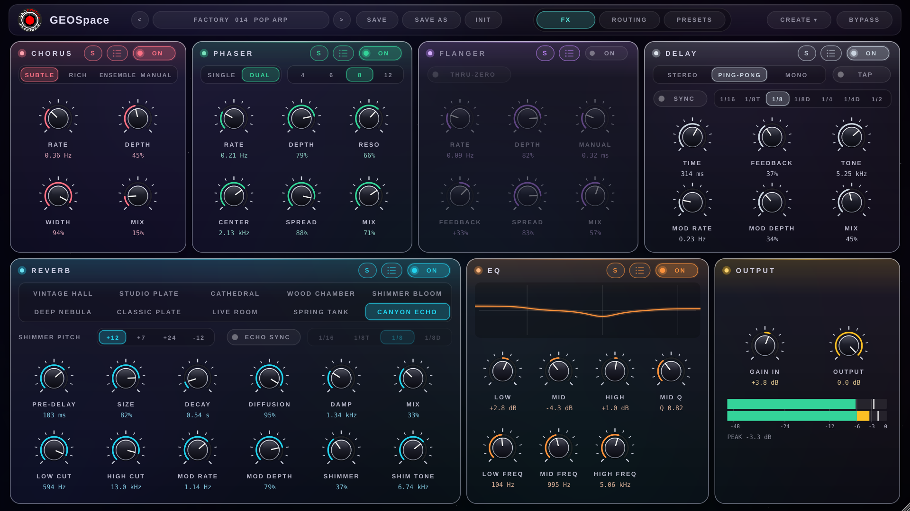
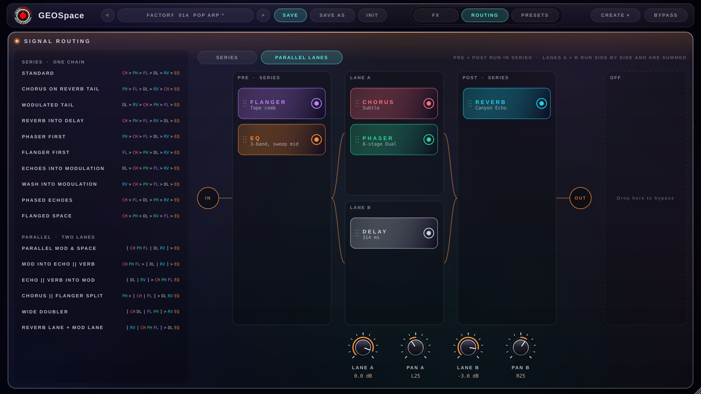
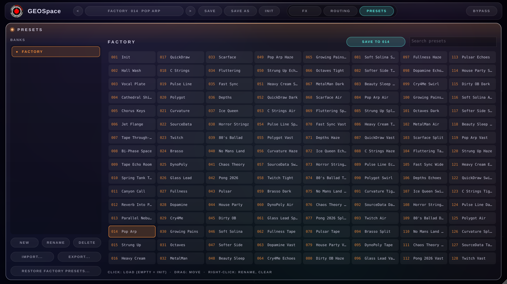
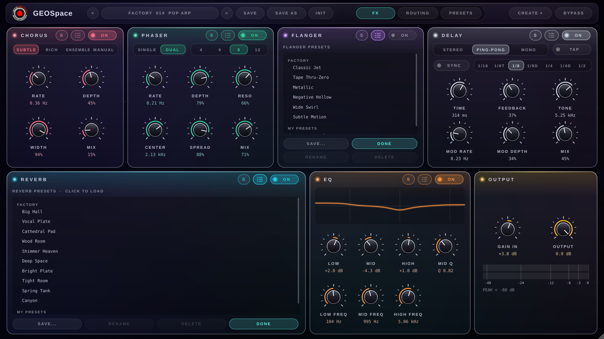
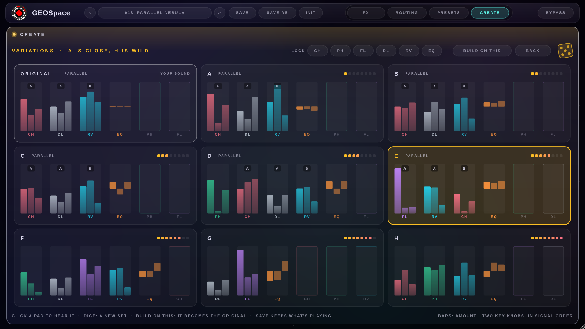

# GEOSpace

**Stereo multi-FX for synths by [GEOSynths](https://www.geosynths.com/).** Free for macOS and Windows.

Chorus, Phaser, Flanger, Delay, Reverb and a 3-band EQ, in any order or in two parallel lanes,
with banks of 128 presets (one for each patch on your synth) and a level-safe output stage.

## Download

**[Get the latest version from Releases](../../releases/latest)**

| | File | Installs |
|---|---|---|
| **macOS** 11 Big Sur or later, Apple Silicon and Intel | `GEOSpace-x.y.z.pkg` | AU (Logic Pro, GarageBand, MainStage) and VST3 |
| **Windows** 10 / 11, 64-bit | `GEOSpace-x.y.z-Windows-Setup.exe` | VST3 and the Standalone app |

### Installing on a Mac
1. Quit your DAW.
2. Double-click **GEOSpace-x.y.z.pkg** and follow the steps (it's signed and notarized by Apple).
3. Open your DAW. In Logic Pro, GEOSpace is under **Audio FX → GEOSynths → GEOSpace**.

Prefer to install by hand? The **.dmg** holds the AU and VST3 to drag into
`/Library/Audio/Plug-Ins/Components` and `/Library/Audio/Plug-Ins/VST3`.

### Installing on Windows
1. Quit your DAW.
2. Run **GEOSpace-x.y.z-Windows-Setup.exe**. Windows may say *"Windows protected your PC"*
   because the installer isn't code-signed yet: click **More info → Run anyway**.
3. Open your DAW and rescan plug-ins if it doesn't find GEOSpace by itself.

### Finding GEOSpace in your DAW
GEOSpace is an audio effect from **GEOSynths**: put it on the track (or bus) your synth plays on.

| DAW | Where it is |
|---|---|
| **Logic Pro, MainStage, GarageBand** | Audio FX slot → **Audio Units → GEOSynths → GEOSpace** |
| **Ableton Live** | Browser → **Plug-ins → VST3** (or **Audio Units** on a Mac) **→ GEOSynths → GEOSpace**. If it's missing, turn on *Use VST3 Plug-in System Folders* in Settings → Plug-ins and click Rescan. |
| **Cubase, Nuendo** | Insert slot → **GEOSynths → GEOSpace** (plug-in list sorted by vendor) |
| **Studio One** | Browser → Effects, sorted by vendor → **GEOSynths → GEOSpace** |
| **Bitwig Studio** | Browser → plug-ins, filtered by creator **GEOSynths** → GEOSpace |
| **Reaper** | Add FX → **VST3** (or **AU**), or **By developer → GEOSynths** → GEOSpace |
| **FL Studio** | Options → Manage plugins → **Find installed plugins**, then in a mixer insert slot pick **GEOSpace** (favourite it to keep it at the top) |

Not listed? Rescan plug-ins in your DAW's settings. On a Mac, Logic and other AU hosts check
new plug-ins when they start, so quit and reopen. Pro Tools isn't supported (it needs the AAX
format).

### Using MIDI Learn in your DAW
Right-click a GEOSpace knob → **MIDI Learn**, then move a knob on your MIDI controller. GEOSpace
is an audio effect, so MIDI must be routed to it (a controller plugged in isn't enough); if the
**Learn** chip in GEOSpace's header keeps waiting, it isn't receiving MIDI.

| DAW | Send MIDI to GEOSpace |
|---|---|
| **Logic Pro** | GEOSpace window → **Side Chain** menu → the track or MIDI input your controller plays (keep it selected or record-enabled). Or use Logic's own **Learn** (Cmd-K) to map a controller to any GEOSpace knob. |
| **Ableton Live** | MIDI track → **MIDI To**: the track with GEOSpace, then **GEOSpace**; Monitor **In**. Or Live's MIDI Map mode (Cmd/Ctrl-M). |
| **Reaper** | A MIDI send from the controller's track to the GEOSpace track. |
| **Bitwig, Cubase, Studio One** | Set the GEOSpace track's MIDI input to your controller, or route a MIDI track to it. |

## What's inside

- **Chorus**: BBD-style with Subtle, Rich, Ensemble and Manual modes.
- **Phaser**: 4 to 12 stages, Single or Dual (bi-phase).
- **Flanger**: with through-zero.
- **Delay**: tape/BBD voicing, tempo sync and tap tempo; Stereo, Ping-Pong or Mono repeats.
- **Reverb**: ten models from small rooms to huge spaces, with shimmer.
- **EQ**: 3 bands.
- **Routing**: drag the effects into any order, or split them into two parallel lanes with
  their own level and pan.
- **Output**: Gain In to even out quiet and loud patches, Output, and a hidden limiter that
  keeps GEOSpace from ever clipping.
- **128 factory presets**: original sounds and level-matched variations of them, in a Factory
  bank you can edit.
- **Presets**: banks of 128 slots, effect presets on the back of every effect card, and bank
  export/import to share sounds.
- **Solo** on every effect, to hear exactly what it does while you set it up.
- **Create**: eight variations of your sound, from close to wild, to audition with a click;
  roll the dice for more, build on the one you like, lock effects you want to keep.
- **Built-in guide**: click the GEOSynths logo inside GEOSpace.

| Routing | Presets |
|---|---|
|  |  |

## Updates and support

New versions appear on the [Releases](../../releases) page, each with a list of what changed.
The full version history is also inside GEOSpace (click the logo → Version History).

Questions, bugs and preset ideas: **[www.geosynths.com](https://www.geosynths.com/)**

## Licence

GEOSpace is free to download and use, including in commercial music productions. It may not be
sold, rented or redistributed, modified or reverse-engineered without written permission from
GEOSynths. It is provided "as is", without warranty.

© 2026 GEOSynths. VST is a registered trademark of Steinberg Media Technologies GmbH.
